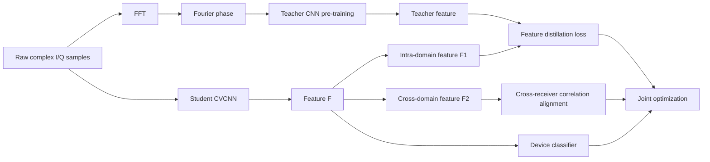

# Receiver-Agnostic Radio Frequency Fingerprinting via Domain-Invariant Feature Learning

Official PyTorch implementation of:

> **Receiver-Agnostic Radio Frequency Fingerprinting via Domain-Invariant Feature Learning**  
> Zhenxin Cai, Yue Yin, Yu Wang, Guan Gui, and Jin Sha  
> *IEEE Communications Letters*, vol. 29, no. 10, pp. 2396–2400, Oct. 2025  
> DOI: [10.1109/LCOMM.2025.3598034](https://doi.org/10.1109/LCOMM.2025.3598034)

[](https://doi.org/10.1109/LCOMM.2025.3598034)
[](https://pytorch.org/)
[](https://cores.ee.ucla.edu/downloads/datasets/wisig/)
[](#license)

---

## Overview

Radio frequency fingerprinting (RFF) identifies wireless transmitters through device-specific hardware imperfections embedded in their emitted RF signals. In practical Internet of Things deployments, however, signals are often collected by heterogeneous receivers. Receiver hardware differences, channel conditions, and noise fluctuations can cause substantial cross-receiver distribution shifts, leading to severe performance degradation when a model is deployed on previously unseen receivers.

This work proposes a **receiver-agnostic RFF framework** that learns domain-invariant representations from two complementary perspectives:

1. **Intra-domain invariant feature learning:** Fourier phase information is used to pre-train a lightweight teacher CNN. Feature-level knowledge distillation transfers the relatively receiver-robust phase representation to the student network.
2. **Cross-domain invariant feature learning:** A correlation-alignment objective minimizes discrepancies in the first- and second-order statistics of features collected by different training receivers.

The student is implemented as a **complex-valued convolutional neural network (CVCNN)**. Its learned representation is divided into two complementary parts: `F1`, supervised by the phase-based teacher, and `F2`, aligned across receiver domains. Only the trained student network is required during inference.

---

## Method



### Fourier Phase-Driven Knowledge Distillation

For a complex I/Q sequence `x(n)`, the Fourier transform and phase are computed as

```text
F(k) = FFT{x(n)},
phase(k) = angle(F(k)).
```

The phase sequence is used to train the teacher CNN. During student training, the intra-domain feature component is guided by the teacher through

```text
L_IDIFE = MSE(F_teacher, F1).
```

### Cross-Domain Correlation Alignment

For cross-domain feature subsets `C_i` and `C_j` sampled from two receivers, the framework aligns their means and covariance matrices:

```text
L_CDIFE = (1 / d)   ||mu_i - mu_j||_2^2
         + (1 / d²) ||Sigma_i - Sigma_j||_F².
```

The complete training objective is

```text
L_total = L_CE + lambda * L_IDIFE + beta * L_CDIFE,
```

where `L_CE` is the device-classification loss, while `lambda` and `beta` control the two invariant-feature objectives.

---

## Repository Structure

```text
Receiver-agnostic-RFFI-CL-/
├── Network1.py             # Student complex-valued CNN
├── teacherNet.py           # Phase-based teacher CNN
├── complex.py              # Complex-valued 1-D convolution implementation
├── pretrain.py             # Teacher-network pre-training
├── train_DIFEX1.py         # Student training, validation, testing, and t-SNE
├── data_loader.py          # WiSig loading, normalization, masking, and AWGN utilities
├── confusion_matrix.py     # Confusion-matrix evaluation and visualization
├── mmd_loss.py             # Auxiliary distribution-discrepancy utilities
├── run_DIFEX.sh            # Grid search over lambda and beta
├── Receiver_agnostic.zip   # Packaged code archive
├── output.log              # Example output log
└── README.md
```

---

## Requirements

A CUDA-capable GPU is recommended. Install the principal dependencies with

```bash
pip install torch torchvision numpy scikit-learn matplotlib tensorboard
```

The code was developed with PyTorch and uses `torch.fft`, complex tensors, TensorBoard, and scikit-learn t-SNE. Use mutually compatible Python, PyTorch, and CUDA versions.

---

## Dataset

Experiments use the public **WiSig** RF fingerprinting dataset:

- Official page: <https://cores.ee.ucla.edu/downloads/datasets/wisig/>
- Dataset paper: S. Hanna, S. Karunaratne, and D. Cabric, “WiSig: A Large-Scale WiFi Signal Dataset for Receiver and Channel Agnostic RF Fingerprinting,” *IEEE Access*, vol. 10, pp. 22808–22818, 2022.

The experimental configuration contains:

| Item | Setting |
|---|---:|
| WiFi transmitters | 6 |
| USRP receivers | 12 |
| Original packets per transmitter–receiver pair | 1,000 |
| Packets randomly selected for the experiments | 200 |
| Complex I/Q samples per packet | 256 |
| Device classes | 6 |

Use the **equalized 256-sample identification signals**, because the paper applies WiFi-preamble equalization before model training. Each receiver must belong exclusively to either the training set or the test set; receiver overlap between the two sets is not allowed.

A convenient processed layout is

```text
data/
└── wisig_equalized/
    ├── Rx1.npy
    ├── Rx2.npy
    ├── ...
    ├── Rx12.npy
    └── labels.npy
```

After loading, each receiver array should be arranged as

```text
[number_of_packets, 2, 256]
```

where the two channels correspond to the real and imaginary components of the I/Q samples. Labels should represent the six transmitters using class indices `0`–`5`.

> **Important:** The released scripts contain local absolute paths. Update the paths in `data_loader.py`, `pretrain.py`, and `train_DIFEX1.py` before running the code.

---

## Experimental Protocol

Let

```text
R = number of training receivers : number of test receivers.
```

The paper evaluates the following strictly disjoint receiver configurations:

```text
4:8, 5:7, 6:6, 7:5, 8:4, and 9:3.
```

For each configuration:

1. Choose the specified number of receivers as source domains.
2. Use the remaining receivers only for testing.
3. Randomly select 200 packets for every transmitter–receiver pair.
4. Pre-train the teacher on Fourier phase sequences from the source receivers.
5. Train the student CVCNN with classification, distillation, and cross-receiver alignment losses.
6. Evaluate the trained student on receivers that were never used during training.

When changing the number of source receivers, update the receiver lists, domain labels, batch sampler, and pairwise alignment loop consistently in `train_DIFEX1.py`.

---

## Quick Start

### 1. Clone the Repository

```bash
git clone https://github.com/Edith-xx/Receiver-agnostic-RFFI-CL-.git
cd Receiver-agnostic-RFFI-CL-
```

### 2. Create Output Directories

```bash
mkdir -p model_weight logs tsne
```

### 3. Configure Data Paths

Modify the local paths in the following files:

```text
data_loader.py
pretrain.py
train_DIFEX1.py
```

Also configure the training and test receiver IDs for the desired `R` setting.

### 4. Pre-Train the Phase Teacher

```bash
python pretrain.py
```

The student-training script expects the teacher checkpoint at

```text
model_weight/pretrain.pth
```

### 5. Train the Receiver-Agnostic Student

The released code uses the following defaults:

| Hyperparameter | Default |
|---|---:|
| Batch size per receiver | 32 |
| Epochs | 100 |
| Optimizer | Adam |
| Learning rate | 0.001 |
| `lambda` | 0.05 |
| `beta` | 0.01 |
| Random seed | 300 |

Run one configuration with

```bash
python train_DIFEX1.py --lam 0.05 --beta 0.01
```

The expected checkpoints are

```text
model_weight/pretrain.pth
model_weight/model.pth
```

The method assumes that the student representation is divided into two equal-dimensional components, `F1` and `F2`. Ensure that the output dimension defined in `Network1.py` is consistent with the split index used in `train_DIFEX1.py`.

### 6. Hyperparameter Search

The paper evaluates

```text
lambda, beta ∈ {1.0, 0.5, 0.1, 0.05, 0.01, 0.005, 0.001}.
```

Run the supplied grid-search script with

```bash
bash run_DIFEX.sh
```

On Windows, use WSL or Git Bash, or execute the corresponding Python commands manually.

### 7. TensorBoard

```bash
tensorboard --logdir logs
```

### 8. Evaluation and Visualization

`train_DIFEX1.py` contains test-set inference and t-SNE visualization. The confusion-matrix utility is provided in

```text
confusion_matrix.py
```

Before evaluation, verify that the model checkpoint and output paths point to valid local locations.

---

## Results

### Comparison with Domain-Generalization Baselines

The proposed method is compared with Mixup, TFmix, MLDG, CORAL, and DANN. It achieves the highest identification accuracy across all evaluated training–testing receiver ratios, showing that the phase-guided intra-domain representation and cross-receiver correlation alignment are complementary.

### Ratio of Invariant Features

Identification accuracy (%) for different allocations of `F1` and `F2`:

| `F1` | `F2` | `R=4:8` | `R=5:7` | `R=6:6` | `R=7:5` | `R=8:4` | `R=9:3` | Average |
|---:|---:|---:|---:|---:|---:|---:|---:|---:|
| 100% | 0% | 77.16 | 85.30 | 88.33 | 91.17 | 84.06 | 92.08 | 86.35 |
| 75% | 25% | 78.47 | 85.11 | 90.57 | 90.47 | 86.33 | 90.14 | 86.85 |
| **50%** | **50%** | **80.80** | **87.17** | **92.50** | **91.83** | **89.66** | **93.13** | **89.18** |
| 25% | 75% | 77.97 | 86.62 | 90.61 | 90.83 | 88.79 | 91.31 | 87.69 |
| 0% | 100% | 76.01 | 85.77 | 88.33 | 91.17 | 84.06 | 91.17 | 86.09 |

The balanced `50%:50%` allocation performs best in every reported receiver configuration. It reaches **93.13%** accuracy for `R=9:3` and an average accuracy of **89.18%** across all six settings.

### Robustness

The paper evaluates two deployment-oriented disturbances:

- **AWGN:** SNR levels from 20 dB to 0 dB;
- **Partial signal loss:** random input masking ratios from 5% to 25%.

Accuracy decreases as noise intensity or mask ratio increases. Nevertheless, the model remains above 80% accuracy for every receiver configuration at a 25% mask ratio, and exceeds 85% for `R=9:3`. The results also show that greater diversity among training receivers improves robustness to both noise and missing samples.

---

## Reproducibility Notes

- The teacher must be pre-trained before student optimization.
- Training and test receiver sets must remain completely disjoint.
- Use equalized complex I/Q packets with 256 samples.
- Keep the feature split between `F1` and `F2` consistent with the selected ratio.
- When reproducing a new `R` setting, update every source-domain count used by the sampler and correlation-alignment computation.
- The published results use 200 randomly selected packets per transmitter–receiver pair; fix random seeds when comparing methods.
- The teacher and domain-invariant losses are training-only. Deployment requires only the trained student CVCNN and classifier.

---

## Citation

```bibtex
@article{cai2025receiver,
  author  = {Cai, Zhenxin and Yin, Yue and Wang, Yu and Gui, Guan and Sha, Jin},
  title   = {Receiver-Agnostic Radio Frequency Fingerprinting via Domain-Invariant Feature Learning},
  journal = {IEEE Communications Letters},
  volume  = {29},
  number  = {10},
  pages   = {2396--2400},
  year    = {2025},
  doi     = {10.1109/LCOMM.2025.3598034}
}
```

Please also cite the WiSig dataset when using its signals:

```bibtex
@article{hanna2022wisig,
  author  = {Hanna, Samer and Karunaratne, Samurdhi and Cabric, Danijela},
  title   = {WiSig: A Large-Scale WiFi Signal Dataset for Receiver and Channel Agnostic RF Fingerprinting},
  journal = {IEEE Access},
  volume  = {10},
  pages   = {22808--22818},
  year    = {2022},
  doi     = {10.1109/ACCESS.2022.3154790}
}
```

---

## Acknowledgements

This repository uses the public WiSig dataset released by the UCLA CORES Laboratory. We thank the dataset authors and the open-source PyTorch community.

---

## License

This repository is released under a **custom non-commercial license**. Any form of commercial use is prohibited.

The WiSig dataset is distributed under its own license. Users must comply with the terms specified by the original dataset provider.

---

## Contact

For questions about the paper or code, please contact the authors through the email addresses listed in the paper.
